# Roadmap

## Remediation

- `docs/changes/archive/2026-07-30-concise-landing-output/` (landed) — make `land` print a compact mutation inventory by default and expose the complete diff only through an explicit flag; depends on the landed transactional command
- `docs/changes/archive/2026-07-30-actionable-lifecycle-diagnostics/` (landed) — give acceptance, start, mechanical reconciliation, and landing one stable value-free lifecycle diagnostic taxonomy; depends on accepted state and mechanical reconciliation
- `docs/changes/optional-project-memory/` (proposed) — make repository artifacts sufficient for every lifecycle phase and keep external project memory optional and explicitly authorized; depends on the landed portable install contract
- `docs/changes/archive/2026-07-27-reuse-document-discovery-for-secret-scanning/` (landed) — run document discovery once and feed its exact selected path set to both graph validation and value-free secret scanning; depends on the landed secret-handling and discovery changes
- `docs/changes/archive/2026-07-23-secret-handling-guardrails/` (landed) — scanner and redacted
  diagnostics
- `docs/changes/archive/2026-07-23-global-cwd-independent-cli/` (landed) — packaged resolver with an
  explicit, fail-closed CLI; depends on the landed secret-handling guardrails
- `docs/changes/archive/2026-07-23-transactional-land-command/` (landed) — one resumable dry-runnable operation for
  preflight, archive, stamping, roadmap regeneration, and validation; depends on the packaged CLI
- `docs/changes/archive/2026-07-23-discovery-lifecycle-hardening/` (landed) — tracked/declared discovery, explicit
  untracked opt-in, root-node policy, repository-relative classification, actionable hash states,
  and baseline-vs-new warning reporting; depends on the landed transactional land command
- `docs/changes/archive/2026-07-23-edge-fingerprint-policy/` (landed) — make dependency fingerprints advisory by
  default while retaining strict frozen-document `self_hash`; depends on the landed discovery and
  lifecycle hardening change
- `docs/changes/archive/2026-07-23-portable-install-contract-convergence/` — templates and install guidance now use
  `.doc-contract.toml` plus the packaged/vendored CLI, with sync-to-check proven in a clean
  temporary repository; depends on the landed edge-fingerprint policy

## Architecture

- `docs/changes/archive/2026-10-13-reflect-project-evidence/` (landed) — add project-scoped, evidence-backed reflection that keeps semantic source/analyzer adapters outside the deterministic stdlib resolver and emits only governed reports and remediation proposals; depends on the portable install boundary, unified verification guardrails, and explicit accepted state
- `docs/changes/archive/2026-07-29-accepted-change-state/` (landed) — add explicit `accepted`, `accept`, and `begin` transitions, reusable transactional lifecycle planning, and in-progress-only landing; depends on the landed transaction and graph-projection boundaries
- `docs/changes/archive/2026-07-24-landed-graph-transition-ownership/` (landed) — move projected landed document
  state, topology, roadmap rendering, and validation behind one resolver-owned operation; depends on
  the landed edge-fingerprint policy
- `docs/changes/archive/2026-07-24-unified-offline-live-verification/` (landed) — consolidate check and landing
  capability policy, redacted execution, status/finding mapping, and warning composition behind one
  internal verification operation; depends on the landed edge-fingerprint policy
- `docs/changes/archive/2026-07-24-always-valid-repository-settings/` (landed) — make every direct or TOML-backed
  settings construction enforce the same immutable repository invariants; depends on the landed
  portable install contract convergence
- `docs/changes/archive/2026-07-24-vendored-runtime-closure/` (landed) — make sync materialize one deterministic,
  complete runtime image whose isolated launcher and manifest share the installed package identity;
  depends on the landed portable install contract convergence
- `docs/changes/runtime-source-provenance/` (proposed) — let the running runtime name its own source, commit, and upstream location so an agent can reach the code it is executing instead of guessing or trusting a stale client copy; depends on the landed vendored runtime closure, portable install boundary, and global cwd-independent CLI

## Lifecycle

- `docs/changes/archive/2026-10-08-canonicalize-roadmap-status-transitions/` (landed) — make `accept` and `begin` canonicalize every validator-supported source-status presentation for their permitted transition instead of failing after a zero-substitution rewrite; depends on accepted state and resolver-owned graph projection
- `docs/changes/archive/2026-10-12-skill-routing-surface/` (landed) — make the portable skill route by user intent with stated status preconditions and stop rules, move the once-per-repository setup into a bundled guide, and bring the routing description back inside the spec limit; depends on accepted state, mechanical reconciliation, actionable lifecycle diagnostics, and the portable install contract
- `docs/changes/proportional-accepted-work-contract/` (proposed) — make substantial accepted artifacts state requirements, exclusions, verification modes, and risk-triggered evidence or side-effect controls without adding runtime prose judgment; depends on accepted state and mechanical reconciliation
- `docs/changes/review-bound-acceptance-plan/` (proposed) — expose a versioned content-free acceptance manifest and bind reviewed dry-run scope to mutation through an apply-time expected plan identifier; depends on accepted state, mechanical reconciliation, and actionable lifecycle diagnostics
- `docs/changes/supersede-unaccepted-proposal/` (accepted) — add a packaged supersede transition that retires a never-accepted proposed change into a frozen lineage record instead of the forbidden manual `git mv`; depends on accepted state, the landed transactional archive command, and the frozen `docs/archive/` lineage discovery
- `docs/changes/archive/2026-07-30-mechanical-reconciliation/` (landed) — add a read-only packaged reconciliation report that reuses lifecycle and landing plans while leaving semantic judgment to the skill; depends on accepted state

```mermaid
flowchart TD
    accepted_change_state["accepted-change-state (landed)"]
    actionable_lifecycle_diagnostics["actionable-lifecycle-diagnostics (landed)"]
    always_valid_repository_settings["always-valid-repository-settings (landed)"]
    canonicalize_roadmap_status_transitions["canonicalize-roadmap-status-transitions (landed)"]
    concise_landing_output["concise-landing-output (landed)"]
    discovery_lifecycle_hardening["discovery-lifecycle-hardening (landed)"]
    edge_fingerprint_policy["edge-fingerprint-policy (landed)"]
    global_cwd_independent_cli["global-cwd-independent-cli (landed)"]
    landed_graph_transition_ownership["landed-graph-transition-ownership (landed)"]
    mechanical_reconciliation["mechanical-reconciliation (landed)"]
    optional_project_memory["optional-project-memory (proposed)"]
    portable_install_contract_convergence["portable-install-contract-convergence (landed)"]
    proportional_accepted_work_contract["proportional-accepted-work-contract (proposed)"]
    reflect_project_evidence["reflect-project-evidence (landed)"]
    reuse_document_discovery_for_secret_scanning["reuse-document-discovery-for-secret-scanning (landed)"]
    review_bound_acceptance_plan["review-bound-acceptance-plan (proposed)"]
    runtime_source_provenance["runtime-source-provenance (proposed)"]
    secret_handling_guardrails["secret-handling-guardrails (landed)"]
    skill_routing_surface["skill-routing-surface (landed)"]
    supersede_unaccepted_proposal["supersede-unaccepted-proposal (accepted)"]
    transactional_land_command["transactional-land-command (landed)"]
    unified_offline_live_verification["unified-offline-live-verification (landed)"]
    vendored_runtime_closure["vendored-runtime-closure (landed)"]
    accepted_change_state --> actionable_lifecycle_diagnostics
    accepted_change_state --> canonicalize_roadmap_status_transitions
    accepted_change_state --> mechanical_reconciliation
    accepted_change_state --> proportional_accepted_work_contract
    accepted_change_state --> reflect_project_evidence
    accepted_change_state --> review_bound_acceptance_plan
    accepted_change_state --> skill_routing_surface
    accepted_change_state --> supersede_unaccepted_proposal
    actionable_lifecycle_diagnostics --> review_bound_acceptance_plan
    actionable_lifecycle_diagnostics --> skill_routing_surface
    discovery_lifecycle_hardening --> edge_fingerprint_policy
    discovery_lifecycle_hardening --> reuse_document_discovery_for_secret_scanning
    discovery_lifecycle_hardening --> supersede_unaccepted_proposal
    edge_fingerprint_policy --> landed_graph_transition_ownership
    edge_fingerprint_policy --> portable_install_contract_convergence
    edge_fingerprint_policy --> unified_offline_live_verification
    global_cwd_independent_cli --> runtime_source_provenance
    global_cwd_independent_cli --> transactional_land_command
    landed_graph_transition_ownership --> accepted_change_state
    landed_graph_transition_ownership --> canonicalize_roadmap_status_transitions
    mechanical_reconciliation --> actionable_lifecycle_diagnostics
    mechanical_reconciliation --> proportional_accepted_work_contract
    mechanical_reconciliation --> review_bound_acceptance_plan
    mechanical_reconciliation --> skill_routing_surface
    portable_install_contract_convergence --> always_valid_repository_settings
    portable_install_contract_convergence --> optional_project_memory
    portable_install_contract_convergence --> reflect_project_evidence
    portable_install_contract_convergence --> runtime_source_provenance
    portable_install_contract_convergence --> skill_routing_surface
    portable_install_contract_convergence --> vendored_runtime_closure
    secret_handling_guardrails --> global_cwd_independent_cli
    secret_handling_guardrails --> reuse_document_discovery_for_secret_scanning
    transactional_land_command --> accepted_change_state
    transactional_land_command --> concise_landing_output
    transactional_land_command --> discovery_lifecycle_hardening
    transactional_land_command --> supersede_unaccepted_proposal
    unified_offline_live_verification --> reflect_project_evidence
    vendored_runtime_closure --> runtime_source_provenance
```

<!-- BEGIN GENERATED DAG (regenerate: doc-contract update --repo-root .) -->

<!-- END GENERATED DAG -->
